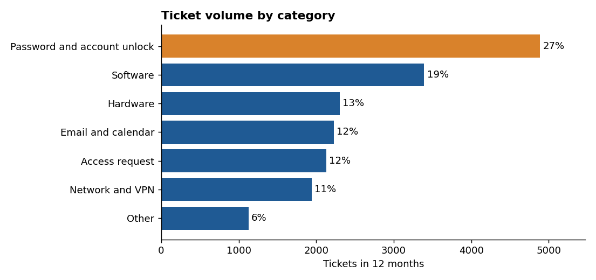
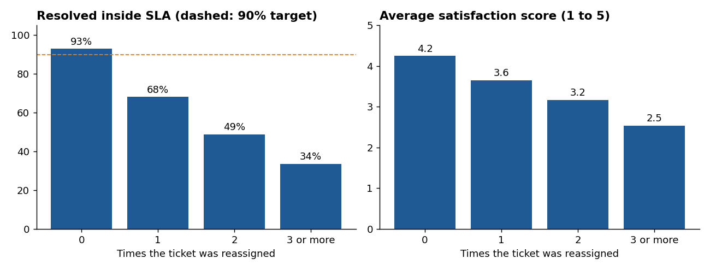
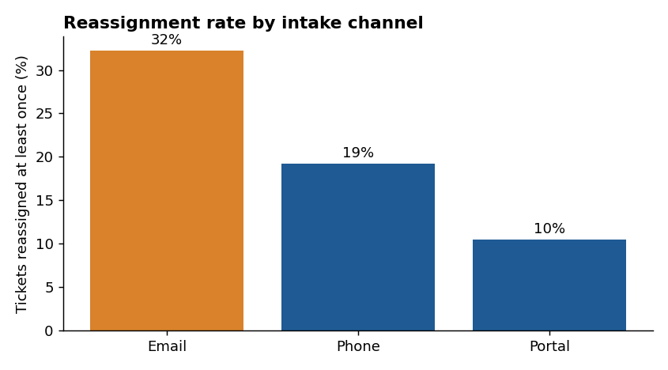
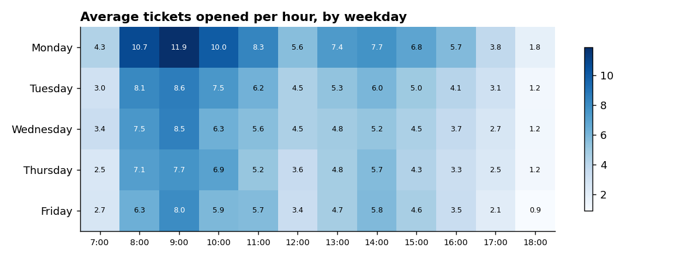
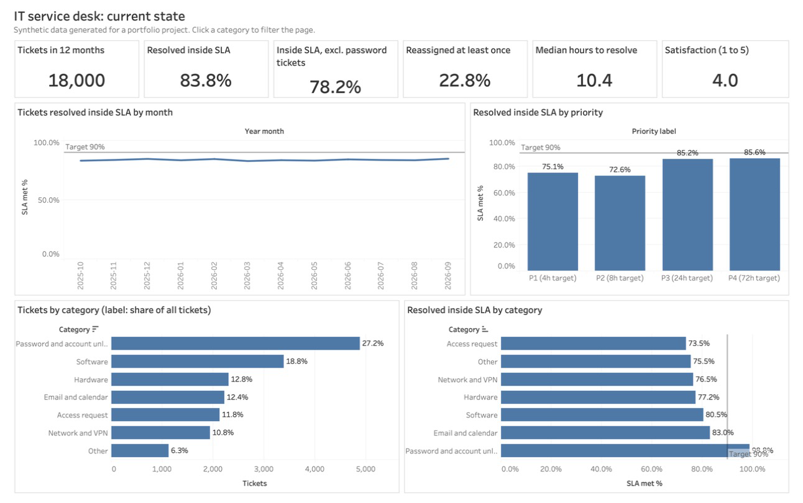

# Service desk process improvement: a business analyst case study

An IT service desk is missing its SLA target and the manager has asked for two more analysts. I used twelve months of ticket data to find where the time goes, then wrote the business analyst documents for a process change: a business case, stakeholder analysis, requirements, process maps, user stories and a KPI framework.

The organisation is fictional and the ticket data is synthetic. I wrote a generator with a fixed seed, so the process problems in the data were put there by me. The project shows how I would run this kind of engagement. It does not report on a real service desk.

## Documents

| Document | What it covers |
|---|---|
| [Business case](docs/01_business_case.md) | Problem, objectives, scope, options, benefit estimate, costs, assumptions, risks |
| [Stakeholder analysis](docs/02_stakeholders.md) | Stakeholder register, power and interest grid, RACI, elicitation approach |
| [Requirements](docs/03_requirements.md) | Business, functional and non-functional requirements with MoSCoW priority and traceability |
| [Process maps](docs/04_process_maps.md) | As-is and to-be flowcharts, pain points linked to evidence |
| [User stories](docs/05_user_stories.md) | Nine stories with Given, When, Then acceptance criteria |
| [KPI framework](docs/06_kpi_framework.md) | KPI definitions, baselines, targets and a benefits realisation plan |

## The data

One row per ticket, 18,000 tickets from October 2025 to September 2026. Each ticket has an opened time, category, intake channel, priority, SLA target, number of reassignments, hours to resolve, analyst handling minutes and an optional satisfaction score.

## Current state

| KPI | Value |
|---|---|
| Tickets per working day | 69 |
| Resolved inside SLA | 83.8% (target 90%) |
| Median time to resolve | 10.4 hours |
| Reassigned at least once | 22.8% |
| Analyst handling hours per year | 8,722 |
| Satisfaction, 1 to 5 | 4.0 from a 33.7% response rate |

## Findings

### Password requests are more than a quarter of all tickets

Password and account unlock is the largest category at 27.2% of tickets. These tickets are quick and 98.8% of them meet the SLA. They still take 803 analyst hours a year.



### The SLA is lost when a ticket is reassigned

Tickets that stay with one team meet the SLA 92.9% of the time, which is above target. After one reassignment the figure drops to 68.0%. After three or more it is 33.6%, and the average satisfaction score falls from 4.2 to 2.5.

Reassigned tickets are 22.8% of volume and 66% of all SLA breaches. More analysts on the front line would not change this, because the delay is in the handover.



### Email tickets are reassigned three times as often as portal tickets

Email tickets are reassigned 32.2% of the time, phone tickets 19.2% and portal tickets 10.5%.

Email might simply attract harder problems. To check, I compared channels inside each category. Email is the worst channel in all seven. For access requests the rate is 63.4% by email and 22.1% by portal. The portal form has required fields and an email does not.



### Monday morning is the peak

Monday has 26.8% of weekday tickets. At 9:00 on a Monday the desk receives 11.9 tickets an hour, against 7.7 to 8.6 on other days.



## Recommendation

Two changes are recommended before any hiring decision. The first is self-service password reset. The second is a structured portal form that replaces the support mailbox and assigns tickets by category.

| Measure | Estimate per year |
|---|---|
| Analyst hours saved | 880, which is 10.1% of handling time |
| Value of hours saved | $48,384 |
| SLA breaches avoided | 372 |
| One-off cost | $35,000 |
| Ongoing cost | $12,000 |
| Payback | About 12 months |

These figures rest on five assumptions listed in the [business case](docs/01_business_case.md). None of them is measured, and the business case names who can confirm each one.

## Two things the analysis turned up that I did not expect

The headline SLA figure falls after the change, from 83.8% to 83.3%. Password tickets nearly always meet the SLA, so removing them makes the remaining tickets look worse. On comparable tickets the SLA improves from 78.2% to 81.0%. The [KPI framework](docs/06_kpi_framework.md) changes the reported measure before go-live for this reason.

The recommended changes do not reach the 90% target. They close about a quarter of the gap on comparable tickets. The rest sits in access requests and in P1 and P2 tickets, which the business case sets aside for a second phase.

## Limits of this analysis

Resolution time is elapsed hours. A real SLA clock usually pauses outside business hours and while the desk waits for the user. The portal benefit assumes an email ticket moved to the portal behaves like today's portal tickets. That is an association and needs a pilot. The cost figures are placeholders until vendor quotes are in.

## Dashboard

The service desk results are also built as a Tableau workbook with three dashboards. The workbook, screenshots and the Power BI build pack are in the [dashboard](dashboard/README.md) folder.



## How to run the analysis

```bash
pip install -r requirements.txt
python src/generate_data.py
python src/ticket_analysis.py
```

The analysis script checks the data, then writes eight tables to `reports/tables/` and four charts to `reports/figures/`.

## Repository layout

```
docs/               six business analyst documents
data/               tickets.csv (synthetic)
src/                data generator and analysis script
reports/tables/     KPI and breakdown tables
reports/figures/    charts
dashboard/          Tableau workbook, screenshots and Power BI build pack
```

## Business analyst skills shown

| Skill | Where |
|---|---|
| Problem definition, objectives and scope | Business case |
| Options analysis and cost-benefit | Business case |
| Stakeholder analysis and RACI | Stakeholder analysis |
| Requirements with priority and traceability | Requirements |
| As-is and to-be process modelling | Process maps |
| User stories and acceptance criteria | User stories |
| KPI design and benefits realisation | KPI framework |
| Data analysis to support each recommendation | `src/ticket_analysis.py` and the findings above |
