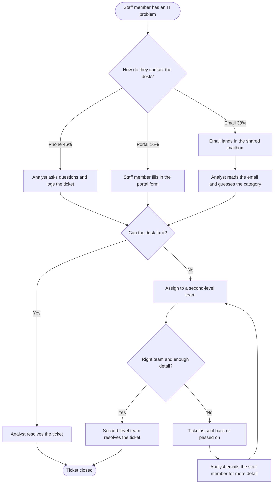
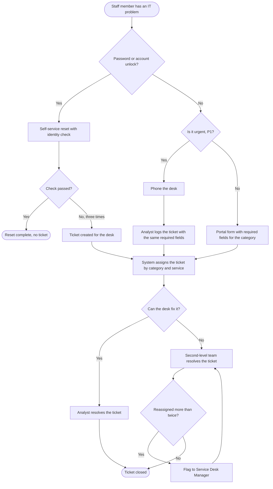

# Process maps

GitHub draws these diagrams from the Mermaid code in this file.

## Current state (as-is)

### Pain points

| # | Step | Problem | Evidence |
|---|---|---|---|
| P1 | Email intake | An email has no required fields, so the analyst has to guess | 32.2% of email tickets are reassigned, against 10.5% for the portal |
| P2 | Assign to second level | Tickets reach the wrong team or arrive without enough detail | 22.8% of tickets are reassigned at least once |
| P3 | Sent back or passed on | Each loop adds waiting time | Median time to resolve is 8.2 hours with no reassignment and 27.1 hours with two |
| P4 | Analyst resolves | Password resets fill the queue | 4,887 password tickets a year |
| P5 | Whole process | Monday morning demand is far above the rest of the week | 11.9 tickets an hour at 9:00 on Monday, 7.7 to 8.6 on other days |

## Future state (to-be)

## What changes

| Pain point | Change | Requirement |
|---|---|---|
| P1 | The mailbox is replaced by a form with required fields | FR5, FR6, FR9 |
| P2 | The system assigns the ticket using category and service | FR7, FR8 |
| P3 | Repeated reassignment is flagged to the manager | RULE3, FR13 |
| P4 | Staff reset their own password | FR1, FR2 |
| P5 | Not changed by this phase | See note below |

The Monday peak is partly password resets after the weekend, so self-service should reduce it. I have not measured by how much, because the ticket extract does not record why a password was reset. Rostering for the Monday peak is a separate recommendation for the Service Desk Manager.
